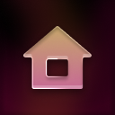
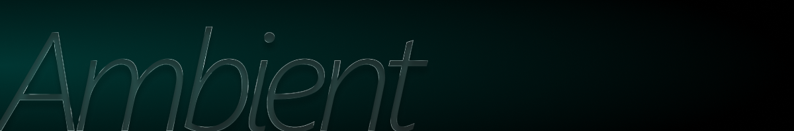
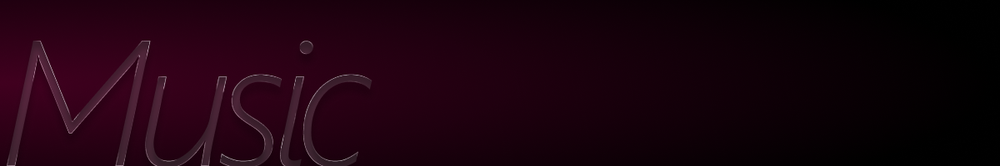
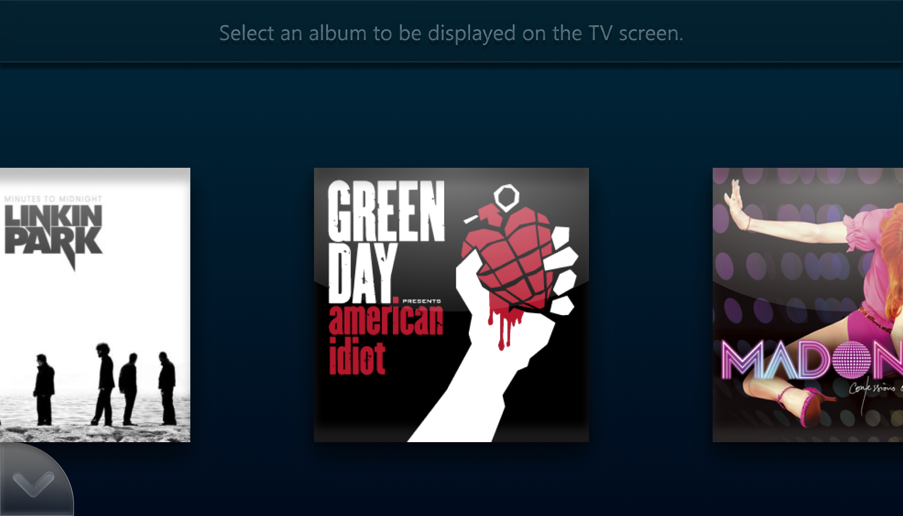
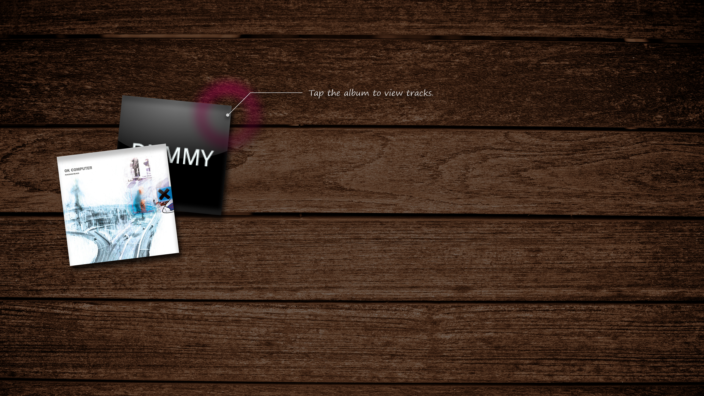

<h1 align="center">SenseU</h1>

Formerly called during development: <b>Wii U PixelSenseMe</b>

<b>SenseU</b> is a Zen Ambient for the Wii U where you can relax and interact with objects from the Wii U GamePad to the TV.

___

In the <b>Ambient</b> mode you can interact with different ambients which have different aspects and objects that you can interact with. 

SenseU serves also as a music player. Music albums can be accessed from the menu of the Wii U GamePad and thrown to the TV screen, from the TV you can interact with the albums with the Wii U GamePad and listen to your favorites songs.      
 
   

